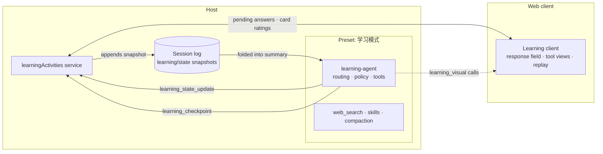

# DSH Interactive Learning

[中文](README.md)

A Learning mode plugin for DeepSeek Harness: a patient tutor that helps you actually understand a concept through natural conversation, native interactive visuals and short reflective pauses, and that simply gives you the answer when that is all you want.

> Built for DeepSeek Harness 0.2.2-rc.1. This repository is private: set up Git access before installing (see [Quick start](#quick-start)).

## What it is

`@dsh-portable/interactive-learning`, at the repository root, adds an opt-in agent preset to DeepSeek Harness, 学习模式 (Learning mode). Its teaching policy is built on evidence-based practices from learning science, and it comes with interactive visuals, skippable reflective pauses and learner state that lives only in the current session. `@dsh-portable/visual`, in `packages/visual`, is the visual core, inlined into Learning at build time. A standalone plugin that lets the model write visuals itself and brings them to every mode is being designed; see the [roadmap](#roadmap).

## Highlights

- **Reads the intent before teaching.** Every message is first classified: do you want to understand something, or get something done? Ordinary tasks are simply done. A learning request opens in one of four ways: a question to calibrate, the smallest useful step, a complete overview, or the study material you asked for.
- **An evidence-based teaching loop.** One step at a time; a fully worked example first, then fading support; you predict, explain, compare or transfer instead of being asked "does that make sense?"; feedback addresses what you actually wrote and names misconceptions plainly, never agreeing with a wrong claim to be kind.
- **Native interactive visuals.** 15 declarative kinds, including function curves with sliders, network and flow diagrams, sequence diagrams, state machines, line-by-line code traces and vector fields, rendered inline, keyboard-operable and with a text alternative.
- **Skippable reflective pauses.** They appear only when your one answer will decide how teaching continues, and you can always skip them. A turn uses at most one interactive tool, and the prose always stands on its own.
- **Learner state for this session only.** It records only what you said and did, to decide the next step. No cross-session profile, and no guessing at personality or "learning styles".
- **Respects what you ask for.** Ask for the answer and you get it; ask it to stop quizzing you and it stops. For graded or submitted work it won't write the answer for you; it teaches the concept and works a parallel example instead.
- **Designed for the prompt cache.** The policy and the tool catalog stay fixed for the whole session, and per-turn changes live only in a dynamic note.

## What is in the repository

| Package | Location | Role | Installable on its own |
|---|---|---|---|
| `@dsh-portable/interactive-learning` | repository root | the 学习模式 preset: teaching policy, visuals, reflective pauses, learner state | yes |
| `@dsh-portable/visual` | `packages/visual` | the visual core: declarative protocol and 15 renderers, inlined into Learning at build time | not yet (see the [roadmap](#roadmap)) |

Learning does not depend on `@dsh-portable/visual` at runtime, so installing it alone gives you everything; the other modes are left completely untouched.

## Quick start

### Requirements

- DeepSeek Harness 0.2.2-rc.1 with the web UI (`dsh web`). Visuals and reflective pauses need the web client; without it, Learning teaches in plain text.
- pnpm on your `PATH`: `dsh plugin` installs plugins with pnpm.
- Git credentials that can read this repository, for example through the GitHub CLI (after `gh auth login`):

```bash
gh auth setup-git
```

### Install

```bash
dsh plugin --profile web add git+https://github.com/wsnxxxs/deepseek-harness-interactive-learning.git
```

The built `lib/` is committed, so nothing is built at install time and pnpm does not ask you to approve build scripts. On DeepSeek Harness Desktop, use `--profile desktop` instead of `--profile web`: open Desktop once so it creates the profile, quit it fully, then run the command.

### Restart and start learning

1. Restart DeepSeek Harness. A running profile reads its plugin list only at startup.

   ```bash
   dsh web
   ```

2. Start a new task and pick 学习模式 in the agent preset selector. The preset is fixed once the task starts; you can also make it the default for new tasks on the Agent presets page in Settings.
3. Ask anything, for example "Bayes' theorem", "teach me recursion" or "make me flashcards on the TCP handshake".

To check the install without booting, print the composed configuration and look for the `interactive-learning` and `preset-learning` rows:

```bash
dsh --profile web --dump-config
```

## How a learning session works

### First: understand something, or get something done?

Every user message first goes through a deterministic classifier (English and Chinese phrasings):

- **Learn intent**: "what is X", a bare concept name, "from zero" or "explain like I'm five", persistent confusion or rustiness, prerequisites and learning paths, "why" and "how come" questions about mechanisms, and requests for quizzes, flashcards or study guides.
- **Ordinary tasks**: writing or debugging code (including "explain this code"), direct calculation, troubleshooting your own setup, translating or polishing text, news and fact lookups, resource recommendations and requests for an opinion. These are simply done; the learning policy does not apply that turn.
- **Current or contested topics** remain learn intent when you want structured understanding. The model searches with `web_search` first, cites what it finds and marks open disagreements.

Then each turn gets an opening route:

| Route | Typical trigger | Opening | Interactive tools this turn |
|---|---|---|---|
| `calibrate` | a bare concept name; a short "teach me X" | one tiny foothold (a one-line intuition or example), then one question whose answer changes the teaching: your goal, context or prior knowledge | none |
| `teach-minimum` | a definition; a clear confusion; "from zero"; a learning path; a specific goal | the smallest useful step right away, with one concrete example | visual or reflective pause |
| `overview` | an explicit request for a full overview; a current or contested topic | a complete, structured explanation directly, with no questions first | visual |
| `direct` | a requested study resource; a deadline stated up front | the resource, built from recall, explanation, comparison and application items; or the answer or fix first, with the underlying idea in one line afterwards | visual (study resources only) |
| `continue` | replies inside an active learning segment | your reply is read against the last move: if it didn't land, a different approach; if you can now do it on your own, the segment closes | visual or reflective pause |
| ordinary task | anything else | done normally | none |

Once a learning segment is active, short answers, continued confusion, pushback and impatience are read as replies to the last move rather than as new requests. An explicit topic switch, "start over", a closing acknowledgement ("got it", "thanks") or a clearly different task ends the segment. After a refresh or restart, an unfinished goal in the learner state keeps the segment going.

### The teaching loop

The teaching policy is under a thousand tokens, with each rule stated once:

- **One step at a time.** The smallest explanation that unlocks the next step, anchored in one concrete example, contrast or worked step, with no survey of what you didn't ask.
- **Worked example, then fading.** For procedures, one example worked fully with the reason for each step, then a similar case with the last step left to you; the more you get right, the less support you get.
- **You produce; it doesn't ask "got it?".** Understanding is checked by having you predict, explain why, compare two cases or apply the idea to a new one. At most one question per reply, only when the answer changes the next move, and with enough to work with that a real attempt is possible.
- **Specific feedback.** Right: a brief why, then a slightly harder next step. Partly right: the right part kept and the missing piece named. Wrong: the misconception named, a counterexample or contrast showing why it fails, then a similar retry. No agreeing with a wrong claim to be kind, no generic praise.
- **Matched to the gap.** A concept gap gets the idea; a procedure gap a different parallel example; a notation gap the symbols decoded; a missing prerequisite that rule first; a misread task a restatement of what is asked.
- **A different approach, not different words.** When you don't follow, repeat an error or go quiet: a smaller step, a switch of representation (rule and example, symbols and numbers, words and picture), or the first step done for you. After two failed attempts, a parallel case worked all the way through. A hint, analogy or question that already failed is never reused.

### Interactive tools

- **Visual**: used when seeing or manipulating one relationship teaches better than prose. The model picks a kind with `learning_visual_select`, stating its purpose and the paired thing to notice or question; on the next step it draws with `learning_visual`, using that kind's schema. The visual renders where the tool call sits; the model then interprets it in prose and asks one paired question or points you to one thing to try.
- **Reflective pause** (`learning_checkpoint`): used when your one response decides the next move. Five shapes: a sentence or two (`free_text`), one option (`single_choice`), a number (`numeric`), what happens next (`prediction`) or a small piece of code (`code_slot`). The message box is replaced by a response field until you submit or skip; text answers submit with Ctrl+Enter (Command+Enter on macOS). The card's header names what you are asked to do ("Make a prediction", "Explain your reasoning", "Draw the contrast", …), and the prompt never contains the answer, a giveaway hint or a rubric. It waits at most 5 minutes; after a skip, cancel or timeout the conversation simply continues.

A user turn uses at most one interactive tool, the reply always stands on its own, and you can skip any interaction. When the route doesn't allow a tool, the call is refused before it runs and the model continues in text.

### When it stops

- Once you have explained or applied the idea correctly on your own (applying it in a new situation is the strongest evidence), the segment ends: the model briefly says what showed it, offers one optional next step and asks nothing more.
- "I get it" alone is not evidence, but "stop quizzing me" stops the questions immediately.
- A goal that spans several steps may get a tentative route of up to 6 steps, but it is not a checklist: as soon as that evidence appears, the segment ends however many steps remain.

### Academic integrity

For graded or submitted work, Learning won't produce the answer or text to hand in. It teaches the concept, works a parallel example and points to the step in your attempt worth revisiting. It asks whether work is assessed only when that is unclear and would change how it helps.

## What the model sees

### Tools and standing cost

Figures are estimates (characters ÷ 4).

| Item | Where | Purpose | ≈ tokens |
|---|---|---|---:|
| Persona | system prompt | a patient, rigorous tutor | 85 |
| Teaching policy `learning:policy` | system prompt | the teaching loop and rules above | 950 |
| `learning_visual_select` | tool | picks a visual kind, with its purpose and the paired thing to notice or question | 440 |
| `learning_visual` | tool | draws the chosen kind; added after the choice and removed after use | 700–1,500 per kind (`plot` ≈ 12k, `field_2d` ≈ 17k) |
| `learning_checkpoint` | tool | reflective pause | 530 |
| `learning_state_update` | tool | session-only learner notes, at most one call per turn | 1,540 |
| Route note `learning:turn-route` | per-turn context | whether this is a learning turn, how to open, which interactive tools are usable | 40–80 |
| Learner state `learning:learner-state` | per-turn context | tentative learner summary; empty until something has been observed | 0–300 |
| `interactive-teaching` skill | loaded on demand | detailed playbooks: diagnosis, academic integrity, study materials, building visuals | on demand |

The first learning turn comes to about 3.6k tokens (not counting `learning_visual`, which is added on demand). The preset also mounts `web_search` (search only, no page fetching), skill loading, context compaction and the current time. It has no shell, file-editing or automation tools, and no generic `ask_user_question`: the reflective pause is Learning's only deliberate wait.

### Designed for the prompt cache

DeepSeek caches the request prefix, and Learning avoids breaking it:

- The policy and the tool catalog stay fixed for the whole session. What varies per turn (intent, opening, usable interactive tools) lives only in the dynamic route note; a call the turn doesn't allow is refused before it runs, with a reason, instead of the tool being removed from the catalog.
- Ordinary-task turns keep the policy and the catalog too; only the learner-state summary is dropped, and the route note tells the model the learning policy doesn't apply.
- The exception is `learning_visual`: it is added after a kind is chosen and removed after use, and the removal invalidates the cached prefix; the `plot` and `field_2d` schemas are also large. The next visual design replaces it with two fixed tools that remove both costs (see the [roadmap](#roadmap)).
- One call records a whole turn's learner notes, and the learner-state summary is absent until something has been observed.

## Learner state

Learning keeps a small, tentative set of teaching notes for the current session only:

| Record | Contents |
|---|---|
| Goal and request kind | your goal in your own words; concept, procedure, source study, practice, study resource and so on |
| Prior knowledge and gaps | what you showed or said you know; gaps in concept, procedure, notation, reading the task or prerequisites; specific misconceptions |
| Signals | whether you can reason it through, progress or being stuck, time pressure, whether the work is assessed |
| Evidence | your latest attempts: kind, correctness, independence, and how confident the assessment is |
| Failed approaches | short labels (such as `analogy:water-pipes`) so they are not repeated |
| Mastery | `unseen` → `emerging` → `transfer` |
| Tentative route | optional, up to 6 steps, advanced only by evidence you produce |

- **Evidence rules.** Only correct, independent attempts assessed with medium or high confidence raise mastery, and `transfer` also requires applying the idea in a new situation. Low-confidence evidence helps choose support but never raises mastery. Your explicit corrections to the notes ("I'm not a beginner", "stop quizzing me") take effect directly; a mastery level you state yourself is marked as coming from your correction, not from evidence.
- **Only facts are recorded automatically.** That a visual was actually shown; the outcome of a reflective pause (a submission only shows that you answered, not that you were right); flashcard self-ratings (recorded as low-confidence and unverified).
- **Where it lives.** Every accepted update appends a full snapshot to the session log as a `learning/state` event. Snapshots carry no session id; the current state is folded from the log when read. The model sees a summary of at most 300 tokens, `<learner_state tentative="true">`, on learning turns only, and a route shows only its objective and current step.
- **Lifecycle.** Refresh and resume fold the same log again; a forked session inherits the snapshots and then diverges independently; a reset (the model can clear the notes when you start over or switch topics) appends a cleared snapshot with a newer revision, so a late asynchronous result cannot bring the old state back, and a pending reflective pause is cancelled; context compaction doesn't affect the state, because it is not part of the message history.
- **What it never does.** No cross-session profile, no inferred personality, emotions or "learning styles", no long-term mastery record. In-visual interactions such as slider positions are not sent to the model.

## Architecture



The bundle patch (`cordis.patch.yml`) adds two rows to the profile:

- `interactive-learning` mounts the `learningActivities` host service at the profile root. It runs reflective-pause waits, reads and writes learner state, serves the flashcard rating route and registers the `learning/state` event type. It registers no model-visible tool or prompt itself.
- `preset-learning` declares the preset `learning` (学习模式), which mounts the persona, `learning-agent`, the current time, the skills shipped in the installed package's `preset/learning/skills`, `web_search` and context compaction.

| Package entry | Loaded by | Purpose |
|---|---|---|
| `.` | the `interactive-learning` row | the `learningActivities` host service |
| `./agent` | the preset's `learning-agent` row | routing, teaching policy, learning tools and visual tools |
| `./client` | the web client (`dsh.client` in `package.json`) | tool views, the reflective-pause response field, replay of retired activities |
| `./protocol` | host and client | closed, versioned data contracts: reflective pauses, retired V1–V3 activities, visual@4 replay |
| `./bootstrap` | embedders that compose their own host | registers the `learning/state` event type before persisted sessions are restored |
| `./installer` | the `dsh-learning-preset` command | removes preset copies left by 0.1.x |
| `./eval` | the `dsh-learning-eval` command and tests | offline teaching evaluation |
| `./preset` | tooling and tests | paths of the skills directory and the bundle patch |

If you compose your own host and restore persisted sessions before plugins load, import the bootstrap first so `learning/state` events validate:

```ts
import '@dsh-portable/interactive-learning/bootstrap'
```

## Upgrading from 0.1.x

Earlier builds targeted DeepSeek Harness 0.1.0-rc.7 and needed `dsh-learning-preset install`, which copied the preset into `~/.dsh/.agent-presets/learning`. DeepSeek Harness 0.2 no longer scans that directory: the preset is declared by this package's bundle patch, so there is nothing to install separately.

1. Upgrade DeepSeek Harness to 0.2.2-rc.1.
2. Run the install command again to fetch the latest commit:

   ```bash
   dsh plugin --profile web add git+https://github.com/wsnxxxs/deepseek-harness-interactive-learning.git
   ```

3. Remove the preset copy left by the old version (recommended):

   ```bash
   dsh plugin --profile web exec dsh-learning-preset uninstall
   ```

   It touches only `~/.dsh/.agent-presets/learning` (`$DSH_HOME/.agent-presets/learning` when `DSH_HOME` is set; append `--home <dir>` to target another DSH home): it deletes files whose content still matches what the old installer wrote, keeps files you edited, and prints the `removed` and `preserved` lists as JSON. Without the old manifest `.dsh-managed.json` it does nothing. DeepSeek Harness 0.2 never reads the files that remain; if you had customized the old preset, override the `preset-learning` row in your profile's `cordis.patch.yml` instead (an override replaces the row's whole `config`).
4. Remove `dsh-learning-preset install` from your scripts. It now performs the same cleanup as `uninstall` and prints a hint.
5. Restart `dsh web`.

Learner-state snapshots keep the same format, and visuals (`learning_visual`), reflective pauses and V1–V3 activities from earlier sessions still replay.

## Uninstall

1. If you upgraded from 0.1.x and haven't removed the old copy yet, do it first (the command goes away with the plugin):

   ```bash
   dsh plugin --profile web exec dsh-learning-preset uninstall
   ```

2. Remove the plugin. The dependency and its configuration layer are removed together:

   ```bash
   dsh plugin --profile web remove @dsh-portable/interactive-learning
   ```

3. Restart `dsh web`.

Sessions created in 学习模式 record the preset id `learning`. While that preset is missing, DeepSeek Harness refuses to resume them; reinstall the plugin to open them again.

## Development

### Repository layout

```text
.
├── src/                       Learning (host and client)
│   ├── agent.ts, agent/       preset-scoped model surface: route note, policy, tools
│   ├── learn-intent.ts        learn-intent classifier
│   ├── teaching-route.ts      per-turn routing
│   ├── teaching-policy.ts     teaching policy
│   ├── learner-state.ts       learner state: reducer, snapshots and summary
│   ├── broker.ts              learningActivities host service
│   ├── protocol.ts            data contracts for reflective pauses, retired activities and visual@4 replay
│   ├── eval.ts                offline teaching evaluation and canary scenarios
│   ├── installer*.ts          dsh-learning-preset: removes old preset copies
│   └── client/                browser side: tool views, response field, locales
├── preset/learning/skills/    the interactive-teaching skill
├── cordis.patch.yml           bundle patch: host service row and the Learning preset row
├── lib/                       committed build output
├── packages/visual/           @dsh-portable/visual: the visual core (declarative protocol and renderers)
├── docs/design/               design documents: the next visual design and its handoff
├── build/tsdown.client.ts     client-bundle preset shared by both packages
├── scripts/                   build and output-check scripts
└── tests/                     vitest specs, browser fixture, package lifecycle tests, real-model canary
```

### Commands

You need Node.js 22 or newer and pnpm 10 (the repository pins pnpm@10.15.1 through `packageManager`). Run everything from the repository root.

| Command | What it does |
|---|---|
| `pnpm install` | installs the workspace |
| `pnpm run build` | builds `packages/visual`, then Learning, each into its own `lib/` |
| `pnpm run typecheck` | type-checks `packages/visual` and Learning's sources and tests |
| `pnpm run test:source` | runs both packages' vitest suites |
| `pnpm test` | runs `typecheck`, `test:source` and `test:package` |
| `pnpm run check` | syntax-checks the built entries and runs the offline evaluation |
| `pnpm run test:package:purity` | checks the published JS and source maps: no machine paths, and Learning's `lib/` never imports `@dsh-portable/visual` at runtime |
| `pnpm run test:package` | builds, packs both packages with `pnpm pack`, installs them into a clean temporary project, resolves every export, checks the bundle patch and client registration, and exercises the legacy preset cleanup |
| `pnpm run eval` | runs the offline teaching evaluation on the built-in hand-written fixtures |
| `pnpm run pack:check` | packs Learning into `output/` |

`pnpm test` and `pnpm run test:package` both rebuild `lib/`.

The offline evaluation checks the grading rubric and protocol invariants; it is not evidence that a model teaches well. It can also grade externally captured candidates (a JSON array or JSONL), labelled `EXTERNAL_INPUT`. Don't put `--` before the path, or pnpm passes the `--` through to the script:

```bash
pnpm run eval path/to/captures.json
```

### Browser fixtures

Both pages load components straight from source. They are quick UI checks, not a substitute for testing in a real `dsh web`.

```bash
pnpm exec vite --config tests/browser/vite.config.mjs
```

Open <http://127.0.0.1:41739/>: Learning's tool views; reflective-pause submit, skip, cancel, draft recovery after refresh and session isolation; and replay of retired activities.

```bash
pnpm exec vite --config packages/visual/tests/browser/vite.config.mjs
```

Open <http://127.0.0.1:41740/>: a gallery of every visual kind.

### Trying changes in a real DeepSeek Harness

Create a separate profile from the web template. It boots right away; press Ctrl+C to stop it:

```bash
dsh learning-dev --from-default-profile web
```

From the repository root, link your checkout into it:

```bash
dsh plugin --profile learning-dev add "link:$PWD"
```

Start that profile:

```bash
dsh learning-dev
```

A linked checkout also runs from `lib/`, so run `pnpm run build` and restart after every change.

### Optional: real-model canary

`tests/model-canary.mts` runs a small set of scenarios against a real model: a learn-intent and routing matrix plus one real visual call. It is a smoke test, not a statistical measure of teaching quality; keep the provenance of real-model results and never report them together with fixture results.

```bash
export DSH_CANARY_API_KEY="your-api-key"
```

```bash
node --experimental-transform-types tests/model-canary.mts
```

| Variable | Meaning |
|---|---|
| `DSH_CANARY_API_KEY` | required |
| `DSH_CANARY_BASE_URL` | OpenAI-compatible Chat Completions endpoint; default `https://api.xiaomimimo.com/v1` |
| `DSH_CANARY_MODEL` | default `mimo-v2.5` |
| `DSH_CANARY_CAPTURE_PATH` | writes the transcript and its provenance to this file, which `pnpm run eval <file>` can grade |

### The committed lib/ policy

Git installs never build, and the runtime only reads `lib/`, so both packages commit their build output. After changing source, run `pnpm run build` and commit `lib/` in the same commit as the source. Builds are reproducible: CSS Module hashes come from package-relative paths, so building unchanged source anywhere yields a byte-identical `lib/`. Learning's `lib/` inlines the visual core and never imports `@dsh-portable/visual` at runtime; `test:package:purity` enforces that.

## Compatibility and known limitations

- Built and tested against DeepSeek Harness 0.2.2-rc.1. The package declares no `engines.dsh` and its host peer dependencies are `*`, so the plugin manager won't stop you from installing it on other versions, but they are untested. DeepSeek Harness 0.1.x is no longer supported.
- Visuals and reflective pauses need the web client; in the TUI, headless, ACP and SDK surfaces Learning teaches in plain text.
- The preset's name and description are Chinese only. DeepSeek Harness doesn't translate the metadata of custom presets, so the English UI also shows 学习模式.
- The learn-intent classifier is a heuristic over English and Chinese phrasings and can misroute; the policy tells the model to follow the learner when the route note clearly misreads them.
- Learner state is session-only: no cross-session mastery, spaced repetition, knowledge graph or LMS integration.
- In-visual interactions (slider positions, the current step) are not sent to the model; if an exact value matters, write it in your reply. Only flashcard self-ratings are recorded, as unverified notes.
- A reflective pause waits at most 5 minutes.

## Roadmap

The next stage lets the model write visuals itself, following the approach of Claude's inline visuals ([announcement](https://claude.com/blog/claude-builds-visuals)). The full design, verified implementation notes and the first work-in-progress sources are in [docs/design/generative-visuals.md](docs/design/generative-visuals.md):

- Two fixed tools: `read_visual_guide` loads drawing guidance on demand, and `show_visual` submits an HTML/SVG fragment the model writes.
- The fragment renders in a sandboxed iframe while it streams, with a design system that follows the host's light and dark themes; Chart.js, D3, Mermaid and KaTeX ship with the plugin and load on demand, so it works offline and on networks in mainland China.
- It becomes a standalone plugin for every mode, and Learning switches to it.
- No replay of old sessions: the declarative renderers, the V1–V3 activities, `learning_visual*` and the flashcard feedback bridge will be deleted; old sessions still open, with their old tool calls shown as generic tool rows.

## License

[MIT](LICENSE)
