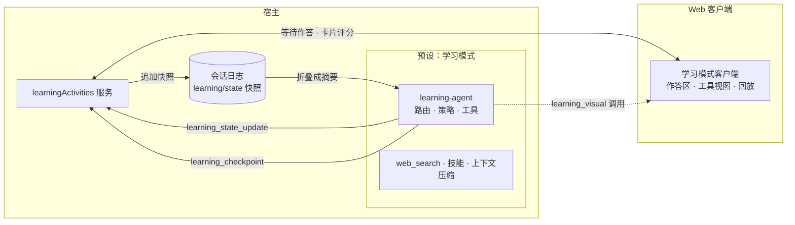

# DSH 交互式学习

[English](README.en.md)

为 DeepSeek Harness 打造的「学习模式」插件：像一位耐心的导师，用自然对话、原生交互图和简短的思考停顿帮你真正弄懂一个概念；你只想要答案时，它也会直接给出。

> 适配 DeepSeek Harness 0.2.2-rc.1。本仓库是私有仓库，安装前需要先配置 Git 访问权限，见[快速开始](#快速开始)。

## 这是什么

仓库根目录的 `@dsh-portable/interactive-learning` 为 DeepSeek Harness 新增一个可选的 Agent 预设「学习模式」：它把学习科学中有实证支持的教学做法写进策略，并配有交互式可视化、可跳过的思考停顿和只在当前会话内有效的学习状态。`packages/visual` 中的 `@dsh-portable/visual` 是可视化核心，构建时内联进学习模式；把可视化改为「由模型直接编写」并开放给所有模式的独立插件正在设计中，见[路线图](#路线图)。

## 亮点

- **先分辨意图，再决定怎么教。** 每条消息都会先判断你是想弄懂一个概念，还是想把一件事办完。普通任务照常完成；学习请求则按情况选择开场：先摸清你的基础、立即讲最小可用的一步、给出完整概览，或直接生成学习资料。
- **有依据的教学循环。** 一次只推进一步；先完整示范例题，再逐步撤掉支架；让你预测、解释、对比或迁移，而不是问「懂了吗」；反馈针对你实际写下的内容，明确点出误解，不会为了客气附和错误。
- **原生交互可视化。** 15 种声明式图形，包括带滑块的函数曲线、网络与流程图、时序图、状态机、代码逐行执行和向量场，在对话中原位渲染，支持键盘操作，并提供文字替代。
- **可跳过的思考停顿。** 只在你的一句回答会决定下一步怎么教时出现，随时可以跳过。每个回合最多使用一种交互工具，正文总能独立读懂。
- **只在本会话内的学习状态。** 只记录你说过、做过的事，用来决定下一步；不跨会话建档，也不推断性格或「学习风格」。
- **尊重你的要求。** 要答案就直接给答案；让它别再提问，它就不再提问。需要评分或提交的作业不代写，而是讲清概念、做一道平行例题。
- **为提示词缓存设计。** 策略和工具目录在整个会话中保持不变，每回合的变化只出现在动态说明里。

## 仓库里有什么

| 包 | 位置 | 作用 | 能否单独安装 |
|---|---|---|---|
| `@dsh-portable/interactive-learning` | 仓库根目录 | 「学习模式」预设：教学策略、可视化、思考停顿、学习状态 | 能 |
| `@dsh-portable/visual` | `packages/visual` | 可视化核心：声明式协议与 15 种渲染器，构建时内联进学习模式 | 暂不能（见[路线图](#路线图)） |

学习模式运行时不依赖 `@dsh-portable/visual`，单独安装就能完整使用；只装学习模式时，其他模式完全不受影响。

## 快速开始

### 环境要求

- DeepSeek Harness 0.2.2-rc.1，并使用 Web 界面（`dsh web`）。交互图和思考停顿需要 Web 客户端；没有 Web 客户端时，学习模式以纯文本方式教学。
- `PATH` 中有 pnpm：`dsh plugin` 通过 pnpm 安装插件。
- 能访问本仓库的 Git 凭据。例如登录 GitHub CLI（`gh auth login`）后执行：

```bash
gh auth setup-git
```

### 安装

```bash
dsh plugin --profile web add git+https://github.com/wsnxxxs/deepseek-harness-interactive-learning.git
```

仓库提交了构建好的 `lib/`，安装时不需要构建，pnpm 也不会要求你批准构建脚本。使用 DeepSeek Harness 桌面版时，把 `--profile web` 换成 `--profile desktop`：先打开一次桌面版以创建 profile，完全退出后再执行命令。

### 重启并开始学习

1. 重启 DeepSeek Harness。正在运行的 profile 只在启动时读取插件列表。

   ```bash
   dsh web
   ```

2. 新建任务，在 Agent 预设选择器中选择「学习模式」。任务开始后预设就固定了；也可以在设置的「Agent 预设」页把它设为新任务的默认预设。
3. 随便问点什么，例如「贝叶斯定理」「教我递归」「给我做一组关于 TCP 握手的抽认卡」。

想在不启动的情况下确认安装结果，可以打印组合后的配置，其中应包含 `interactive-learning` 和 `preset-learning` 两行：

```bash
dsh --profile web --dump-config
```

## 学习会话如何运作

### 先分辨：想弄懂，还是想办成一件事

每条用户消息都会先经过一个确定性的分类器（基于中英文句式）：

- **学习意图**：「什么是 X」、只发一个概念名、零基础或「像给五岁孩子讲」、反复混淆或「有点生疏」、先修知识与学习路径、关于原理的「为什么」「怎么会」、要求出题、制作抽认卡或学习指南。
- **普通任务**：写代码或调试（包括「解释这段代码」）、直接计算、排查自己设备的问题、翻译或润色、新闻与事实查询、推荐资源、征求观点。它们照常完成，学习策略在这一回合不适用。
- **当前或有争议的话题**：如果你想要的是有结构的理解，仍算学习意图。模型会先用 `web_search` 查证，引用找到的来源，并标出仍有争议的地方。

随后为这一回合选择开场方式：

| 路由 | 典型触发 | 开场方式 | 本回合可用的交互工具 |
|---|---|---|---|
| `calibrate` | 只发一个概念名；简短的「教我 X」 | 先给一个小抓手（一句直觉或一个例子），再问一个会改变教法的问题：目标、场景或已有基础 | 无 |
| `teach-minimum` | 定义；明确的困惑；零基础；学习路径；具体的目标 | 立刻讲最小可用的一步，配一个具体例子 | 可视化或思考停顿 |
| `overview` | 明确要求完整概览；当前或有争议的话题 | 直接给出完整、有结构的讲解，不先提问 | 可视化 |
| `direct` | 要求生成学习资料；一开口就说明时间紧迫 | 直接生成资料，题目侧重回忆、解释、对比和应用；或者先给答案或修复方法，再用一句话点出背后的原理 | 可视化（仅限生成学习资料） |
| `continue` | 进行中的学习片段里的回复 | 对照上一步判断是否奏效：没奏效就换一种讲法，你已能独立完成就收尾 | 可视化或思考停顿 |
| 普通任务 | 其他请求 | 照常完成 | 无 |

学习片段开始后，简短的回答、仍然困惑、反驳或催促都会被当作对上一步的回应，而不是新的请求。明确换话题、说「重新开始」、表示结束（「懂了」「谢谢」），或者提出明显不同的任务，都会结束当前片段。刷新页面或重启之后，只要学习状态里还有未完成的目标，片段就会接着进行。

### 教学循环

教学策略不到一千个 token，每条规则只写一次：

- **一次一步。** 用最小的解释打开下一步，并落在一个具体的例子、对比或推导步骤上；不铺陈你没问的内容。
- **先示范，再撤掉支架。** 遇到操作性的内容，先完整演示一道例题并说明每一步的理由，再给一道相似的题、把最后一步留给你；你做对得越多，提示就越少。
- **让你产出，而不是问「懂了吗」。** 通过预测、解释原因、比较两种情况或迁移到新情境来检验理解。每次回复最多一个问题，只在答案会改变下一步时才问，并给出足够的抓手，让你能真正作答。
- **具体的反馈。** 答对了，简要说明为什么对，再把下一步稍微加难；部分正确，肯定对的部分并指出缺失；答错了，点明误解，用反例或对比说明它为什么不成立，再给一道相似的题重试。不为了客气附和错误，也不说空泛的夸奖。
- **对症下药。** 概念不清就讲概念；步骤不会就换一道平行例题；看不懂符号就逐个解读；缺先修知识就先补那条规则；读错了题就先复述题目在问什么。
- **换讲法，而不是换说法。** 你没听懂、重复出错或不再回应时，缩小步子、换一种表征（规则与例子、符号与数字、文字与图），或者先替你做第一步；连续两次不成功，就完整做一道平行题。已经失败的提示、类比或问题不会再用。

### 交互工具

- **可视化**：当「看见或动手操作某个关系」比文字更能讲清楚时使用。模型先用 `learning_visual_select` 选择图形类型，写明用途以及配套的观察点或问题；下一步再按该类型的 schema 调用 `learning_visual` 绘图。图在工具调用的位置原位渲染，随后模型用文字解读它，只提一个配套问题，或指出一个值得观察的操作。
- **思考停顿**（`learning_checkpoint`）：当你的一句回答会决定下一步时使用，共有五种形式：一两句话（`free_text`）、单选（`single_choice`）、一个数字（`numeric`）、预测接下来会发生什么（`prediction`）、一小段代码（`code_slot`）。输入框会暂时换成作答区，直到你提交或跳过；文字作答可按 Ctrl+Enter（macOS 上为 Command+Enter）提交。卡片标题写的是要你做的事（「先做预测」「说明你的理由」「指出两者的差异」……），题目里不含答案、提示性线索或评分标准。最多等待 5 分钟；跳过、取消或超时后，对话照常继续。

每个用户回合最多使用一种交互工具，回复正文总能独立读懂，你可以跳过任何交互。当前路由不允许时，调用会在执行前被拒绝，模型改用文字继续。

### 何时停下

- 当你独立、正确地解释或应用了这个概念（能迁移到新情境是最有力的证据），这一段就结束：模型简要说明是哪个表现说明你已经掌握，给一个可选的下一步，不再追问。
- 「我懂了」本身不算证据；但你说「别再考我了」，提问会立即停止。
- 跨越多个步骤的目标可以有一条暂定路线（最多 6 步），但它不是待办清单：只要出现上面的证据，无论还剩几步都会收尾。

### 学术诚信

面对需要评分或提交的作业，学习模式不会直接给出答案或可以上交的文本，而是讲清概念、做一道平行例题，并指出你的作答中值得重新检查的那一步。只有在情况不明、且会影响帮助方式时，它才会问你这是不是考核作业。

## 模型看到什么

### 工具与固定开销

表中数值按字符数 ÷ 4 估算。

| 内容 | 位置 | 作用 | 约 token |
|---|---|---|---:|
| 角色设定 | 系统提示词 | 耐心、严谨的导师 | 85 |
| 教学策略 `learning:policy` | 系统提示词 | 上文的教学循环与规则 | 950 |
| `learning_visual_select` | 工具 | 选择图形类型，写明用途以及配套的观察点或问题 | 440 |
| `learning_visual` | 工具 | 绘制所选类型；选择之后才加入，用完即移除 | 每种 700–1,500（`plot` 约 12k、`field_2d` 约 17k） |
| `learning_checkpoint` | 工具 | 思考停顿 | 530 |
| `learning_state_update` | 工具 | 写入会话内的学习笔记，每回合最多一次 | 1,540 |
| 路由说明 `learning:turn-route` | 每回合上下文 | 是否为学习回合、怎样开场、可用哪些交互工具 | 40–80 |
| 学习状态 `learning:learner-state` | 每回合上下文 | 暂定的学习者摘要；观察到任何内容之前为空 | 0–300 |
| `interactive-teaching` 技能 | 按需加载 | 诊断、学术诚信、学习资料、构建可视化等细则 | 按需 |

首个学习回合合计约 3.6k token（不含按需加入的 `learning_visual`）。预设另外带有 `web_search`（只搜索，不抓取网页）、技能加载、上下文压缩和当前时间，不含 shell、文件编辑或自动化工具，也不挂载通用的 `ask_user_question`：思考停顿是学习模式中唯一刻意的等待。

### 为提示词缓存而设计

DeepSeek 会缓存请求的前缀，学习模式尽量不破坏它：

- 教学策略和工具目录在整个会话中保持不变。随回合变化的内容（意图、开场方式、可用的交互工具）只写在动态的路由说明里；本回合不允许的调用会在执行前被拒绝并附上原因，而不是把工具从目录中移除。
- 普通任务回合同样保留策略和工具目录，只省略学习状态摘要，路由说明会告诉模型这一回合不适用学习策略。
- 例外是 `learning_visual`：它在选择图形类型后加入、用完即移除，移除会让缓存的前缀失效，而 `plot`、`field_2d` 的 schema 也偏大。下一版可视化改为两个固定工具，消除这两项开销（见[路线图](#路线图)）。
- 一个回合的学习笔记只需一次调用；还没观察到任何内容时，学习状态摘要完全不出现。

## 学习状态

学习模式只为当前会话保存一份小而暂定的教学笔记：

| 记录 | 内容 |
|---|---|
| 目标与请求类型 | 用你自己的话记下的目标；概念、步骤、资料学习、练习、学习资料等 |
| 已有基础与缺口 | 你展示过或说出的已知内容；概念、步骤、符号、读题或先修知识方面的缺口；具体的误解 |
| 状态信号 | 能否自行推理、在进步还是卡住了、时间压力、是否为考核作业 |
| 证据 | 最近几次作答：类型、对错、是否独立完成、评估的把握程度 |
| 失败过的讲法 | 简短的标签（例如 `analogy:water-pipes`），用来避免重复 |
| 掌握度 | `unseen` → `emerging` → `transfer` |
| 暂定路线 | 可选，最多 6 步；只有你产出的证据才能推进 |

- **证据规则。** 只有正确、独立完成、且评估把握为中或高的作答才能提升掌握度；`transfer` 还要求在新情境中应用。把握较低的证据可以帮助选择支架，但不会提升掌握度。你对笔记的明确更正（例如「我不是初学者」「别再考我了」）会直接生效；你自述的掌握程度会被标注为来自你的更正，而不是证据。
- **自动记录的只有事实。** 可视化确实显示过；思考停顿的结果（提交只说明你作答了，不代表答对）；记忆卡片的自评（记为低把握、未经验证）。
- **存放位置。** 每次有效更新都会把一份完整快照作为 `learning/state` 事件追加到会话日志。快照不含会话 id，读取时从日志折叠出当前状态。模型只在学习回合看到一份不超过 300 token 的 `<learner_state tentative="true">` 摘要，路线只显示目标和当前这一步。
- **生命周期。** 刷新和恢复会重新折叠同一份日志；分叉出的会话继承快照，之后各自独立变化；重置（你说「重新开始」或换话题时，模型可以清空笔记）会追加一个清空后的新版本，迟到的异步结果无法让旧状态复活，正在等待的思考停顿也会被取消；压缩上下文不影响状态，因为它不在消息历史里。
- **不做的事。** 不跨会话建档，不推断性格、情绪或「学习风格」，不记录长期掌握度。滑块位置等图上的操作不会回传给模型。

## 架构



bundle patch（`cordis.patch.yml`）向 profile 加入两行：

- `interactive-learning`：在 profile 根部挂载 `learningActivities` 宿主服务，负责思考停顿的等待、学习状态的读写和记忆卡片评分路由，并注册 `learning/state` 事件类型。它本身不注册任何模型可见的工具或提示词。
- `preset-learning`：声明预设 `learning`（「学习模式」），依次挂载角色设定、`learning-agent`、当前时间、从已安装包内 `preset/learning/skills` 读取的技能、`web_search` 和上下文压缩。

| 包入口 | 由谁加载 | 作用 |
|---|---|---|
| `.` | `interactive-learning` 行 | `learningActivities` 宿主服务 |
| `./agent` | 预设中的 `learning-agent` 行 | 路由、教学策略、学习工具和可视化工具 |
| `./client` | Web 客户端（`package.json` 的 `dsh.client`） | 工具视图、思考停顿作答区、旧版活动回放 |
| `./protocol` | 宿主与客户端共用 | 封闭、带版本的数据契约：思考停顿、旧版 V1–V3 活动、visual@4 回放 |
| `./bootstrap` | 自行组装宿主的嵌入方 | 在恢复持久化会话之前注册 `learning/state` 事件类型 |
| `./installer` | `dsh-learning-preset` 命令 | 清理 0.1.x 遗留的预设副本 |
| `./eval` | `dsh-learning-eval` 命令与测试 | 离线教学评估 |
| `./preset` | 工具与测试 | 技能目录和 bundle patch 的路径 |

如果你自己组装宿主，并且会在加载插件之前恢复持久化会话，请先导入 bootstrap，让 `learning/state` 事件能通过校验：

```ts
import '@dsh-portable/interactive-learning/bootstrap'
```

## 从 0.1.x 升级

早期版本面向 DeepSeek Harness 0.1.0-rc.7，需要运行 `dsh-learning-preset install`，把预设复制到 `~/.dsh/.agent-presets/learning`。DeepSeek Harness 0.2 不再扫描这个目录，预设改由本包的 bundle patch 声明，不再需要单独安装。

1. 把 DeepSeek Harness 升级到 0.2.2-rc.1。
2. 重新执行安装命令，拉取最新的提交：

   ```bash
   dsh plugin --profile web add git+https://github.com/wsnxxxs/deepseek-harness-interactive-learning.git
   ```

3. 清理旧版留下的预设副本（建议）：

   ```bash
   dsh plugin --profile web exec dsh-learning-preset uninstall
   ```

   它只处理 `~/.dsh/.agent-presets/learning`（设置了 `DSH_HOME` 时为 `$DSH_HOME/.agent-presets/learning`；要处理另一个 DSH 主目录，在命令末尾加上 `--home <目录>`）：删除内容与旧版安装时完全一致的文件，保留你改过的文件，并以 JSON 列出 `removed` 和 `preserved`。目录中没有旧版清单 `.dsh-managed.json` 时，它什么也不做。DeepSeek Harness 0.2 不会读取保留下来的文件；如果你改过旧预设，请改为在 profile 的 `cordis.patch.yml` 中覆盖 `preset-learning` 这一行（覆盖会替换该行的整个 `config`）。
4. 从脚本中删掉 `dsh-learning-preset install`。它现在只做与 `uninstall` 相同的清理，并打印一条提示。
5. 重启 `dsh web`。

学习状态快照的格式没有变化；较早会话中的可视化（`learning_visual`）、思考停顿和 V1–V3 活动也仍可回放。

## 卸载

1. 如果是从 0.1.x 升级来的、还没清理过旧副本，先执行清理（插件移除后这个命令就没有了）：

   ```bash
   dsh plugin --profile web exec dsh-learning-preset uninstall
   ```

2. 移除插件。依赖和它的配置层会一起移除：

   ```bash
   dsh plugin --profile web remove @dsh-portable/interactive-learning
   ```

3. 重启 `dsh web`。

用学习模式创建的会话记录了预设 id `learning`。预设不存在时，DeepSeek Harness 会拒绝恢复这些会话；重新安装后即可再次打开。

## 开发

### 仓库结构

```text
.
├── src/                       学习模式（宿主与客户端）
│   ├── agent.ts, agent/       预设内的模型界面：路由说明、策略、工具
│   ├── learn-intent.ts        学习意图分类器
│   ├── teaching-route.ts      每回合的路由
│   ├── teaching-policy.ts     教学策略
│   ├── learner-state.ts       学习状态：reducer、快照与摘要
│   ├── broker.ts              learningActivities 宿主服务
│   ├── protocol.ts            思考停顿、旧版活动与 visual@4 回放的数据契约
│   ├── eval.ts                离线教学评估与 canary 场景
│   ├── installer*.ts          dsh-learning-preset：清理旧版预设副本
│   └── client/                浏览器端：工具视图、作答区、语言包
├── preset/learning/skills/    interactive-teaching 技能
├── cordis.patch.yml           bundle patch：宿主服务行与学习模式预设行
├── lib/                       提交到仓库的构建产物
├── packages/visual/           @dsh-portable/visual：可视化核心（声明式协议与渲染器）
├── docs/design/               设计文档：下一版可视化的设计与交接
├── build/tsdown.client.ts     两个包共用的客户端打包配置
├── scripts/                   构建与产物检查脚本
└── tests/                     vitest 用例、浏览器 fixture、打包生命周期测试、真实模型 canary
```

### 常用命令

需要 Node.js 22 及以上和 pnpm 10（仓库通过 `packageManager` 固定为 pnpm@10.15.1）。以下命令都在仓库根目录执行。

| 命令 | 作用 |
|---|---|
| `pnpm install` | 安装工作区依赖 |
| `pnpm run build` | 先构建 `packages/visual`，再构建学习模式，分别输出到各自的 `lib/` |
| `pnpm run typecheck` | 对 `packages/visual` 以及学习模式的源码和测试做类型检查 |
| `pnpm run test:source` | 用 vitest 运行两个包的测试 |
| `pnpm test` | 依次运行 `typecheck`、`test:source` 和 `test:package` |
| `pnpm run check` | 检查构建产物的语法，并运行离线评估 |
| `pnpm run test:package:purity` | 检查发布的 JS 与 source map：不含本机路径，学习模式的 `lib/` 不在运行时导入 `@dsh-portable/visual` |
| `pnpm run test:package` | 构建后用 `pnpm pack` 打包两个包，安装到干净的临时项目，解析所有导出，检查 bundle patch 和客户端注册，并演练旧版预设清理 |
| `pnpm run eval` | 用内置的手写样例运行离线教学评估 |
| `pnpm run pack:check` | 把学习模式打包到 `output/` |

`pnpm test` 和 `pnpm run test:package` 都会重新构建 `lib/`。

离线评估只检验评分规则和协议不变量，不能证明模型真的会教。它也可以给外部采集的结果打分（JSON 数组或 JSONL），结果标记为 `EXTERNAL_INPUT`；路径前不要加 `--`，否则 pnpm 会把 `--` 原样传给脚本：

```bash
pnpm run eval path/to/captures.json
```

### 浏览器 fixture

两个页面都直接从源码加载组件，适合快速检查界面；它们不能替代在真实的 `dsh web` 中测试。

```bash
pnpm exec vite --config tests/browser/vite.config.mjs
```

打开 <http://127.0.0.1:41739/>：学习模式的工具视图，思考停顿的提交、跳过、取消、刷新后恢复草稿和会话隔离，以及旧版活动回放。

```bash
pnpm exec vite --config packages/visual/tests/browser/vite.config.mjs
```

打开 <http://127.0.0.1:41740/>：所有图形类型的画廊。

### 在真实的 DeepSeek Harness 中试用改动

先基于 Web 模板创建一个独立的 profile。它会直接启动，按 Ctrl+C 退出即可：

```bash
dsh learning-dev --from-default-profile web
```

在仓库根目录执行，把本地检出链接进去：

```bash
dsh plugin --profile learning-dev add "link:$PWD"
```

启动这个 profile：

```bash
dsh learning-dev
```

链接的检出同样从 `lib/` 读取代码，所以每次改动后都要运行 `pnpm run build` 并重启。

### 可选：真实模型 canary

`tests/model-canary.mts` 用真实模型跑一组小规模场景：一组学习意图与路由的矩阵，以及一次真实的可视化调用。它只是冒烟测试，不是教学质量的统计结论；真实模型的结果请保留来源信息，不要与样例结果混在一起报告。

```bash
export DSH_CANARY_API_KEY="your-api-key"
```

```bash
node --experimental-transform-types tests/model-canary.mts
```

| 环境变量 | 说明 |
|---|---|
| `DSH_CANARY_API_KEY` | 必填 |
| `DSH_CANARY_BASE_URL` | OpenAI 兼容的 Chat Completions 地址，默认 `https://api.xiaomimimo.com/v1` |
| `DSH_CANARY_MODEL` | 默认 `mimo-v2.5` |
| `DSH_CANARY_CAPTURE_PATH` | 把对话记录和来源信息写入该文件，之后可用 `pnpm run eval <文件>` 打分 |

### 提交 lib/ 的约定

Git 安装不会执行构建，运行时只读取 `lib/`，所以两个包都把构建产物提交在仓库里。修改源码后运行 `pnpm run build`，把 `lib/` 和源码放在同一个提交里。构建是可复现的：CSS Module 的哈希基于包内的相对路径，在任何目录下构建未改动的源码，都会得到逐字节相同的 `lib/`。学习模式的 `lib/` 内联了可视化核心，从不在运行时导入 `@dsh-portable/visual`，`test:package:purity` 会检查这一点。

## 兼容性与已知限制

- 基于 DeepSeek Harness 0.2.2-rc.1 构建和测试。包没有声明 `engines.dsh`，宿主相关的 peer 依赖版本都是 `*`，所以插件管理器不会阻止你安装到其他版本，但其他版本未经测试。本版本不再支持 DeepSeek Harness 0.1.x。
- 交互图和思考停顿需要 Web 客户端；在 TUI、headless、ACP 和 SDK 中只能纯文本教学。
- 预设名称和简介只有中文。DeepSeek Harness 不会翻译自定义预设的元数据，所以英文界面中显示的也是「学习模式」。
- 学习意图分类器是基于中英文句式的启发式规则，可能误判；策略允许模型在路由说明明显误读你时，以你的实际需求为准。
- 学习状态只在本会话内有效：没有跨会话的掌握度、间隔复习、知识图谱或 LMS 对接。
- 图上的操作（滑块位置、当前步骤）不会回传给模型；如果具体数值重要，请在回复里写出来。只有记忆卡片的自评会作为未经验证的笔记记录下来。
- 思考停顿最多等待 5 分钟。

## 路线图

下一阶段把可视化改为「由模型直接编写」，参考 Claude 对话内可视化的做法（[官方介绍](https://claude.com/blog/claude-builds-visuals)）。完整设计、已核实的实现细节和半成品代码见 [docs/design/generative-visuals.md](docs/design/generative-visuals.md)：

- 两个固定工具：`read_visual_guide` 按需加载绘图指南，`show_visual` 提交模型编写的 HTML/SVG 片段。
- 片段在沙箱 iframe 中边生成边渲染，使用跟随宿主浅色/深色主题的设计系统；Chart.js、D3、Mermaid、KaTeX 随插件打包并按需加载，离线和国内网络都可用。
- 作为独立插件开放给所有模式，学习模式也改用它。
- 不再回放旧会话：声明式渲染器、V1–V3 活动、`learning_visual*` 与记忆卡片回传将被删除；旧会话仍能打开，旧的工具调用显示为普通工具行。

## 许可证

[MIT](LICENSE)
